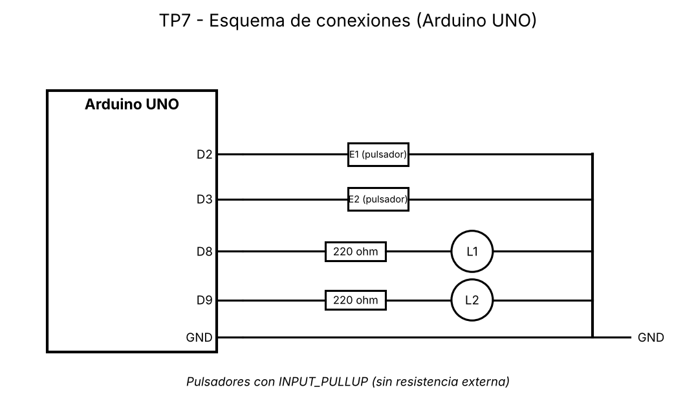

# Esquemático

Diagrama de conexiones del circuito (también armado y simulado en Tinkercad Circuits). Podés reemplazar esta imagen por la captura de tu Tinkercad manteniendo el nombre `esquematico.png`.

## Lista de materiales

| Cantidad | Componente |
|---|---|
| 1 | Arduino UNO |
| 2 | Pulsadores |
| 2 | LEDs |
| 2 | Resistencias de 220 Ω |

## Conexiones

| Componente | Conexión |
|---|---|
| Pulsador 1 | D2 ↔ GND |
| Pulsador 2 | D3 ↔ GND |
| LED 1 | D8 → resistencia 220 Ω → ánodo; cátodo → GND |
| LED 2 | D9 → resistencia 220 Ω → ánodo; cátodo → GND |

Los pulsadores no llevan resistencia externa: el firmware activa la resistencia interna con `INPUT_PULLUP`, por lo que el pin lee `LOW` al pulsar.
